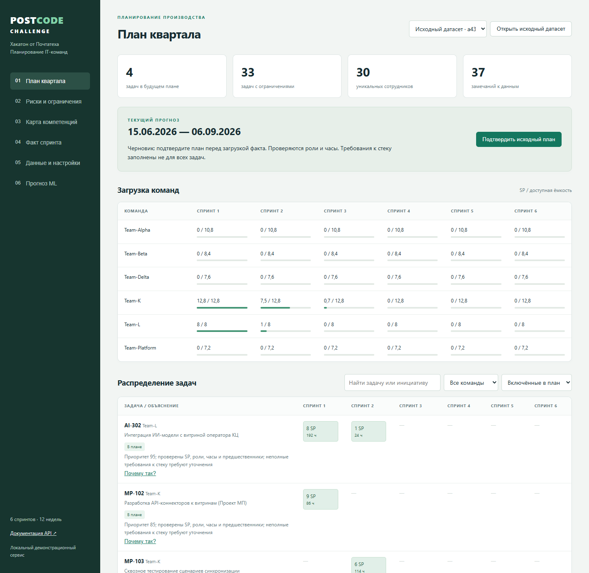
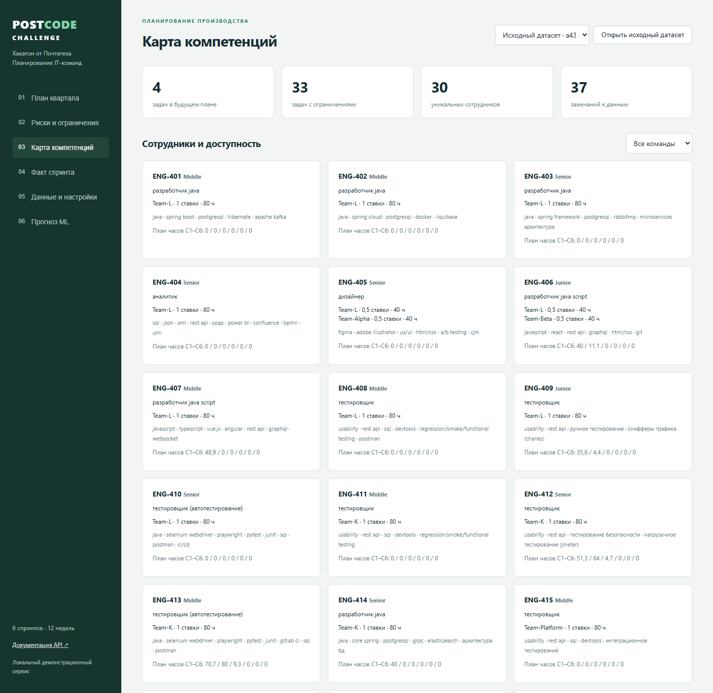
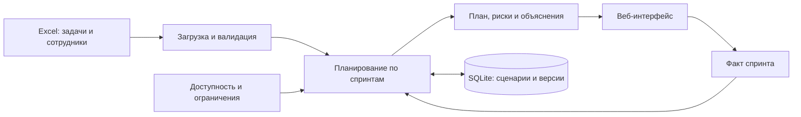

# Хакатон PostCode Challenge от Почтатеха

**Сервис квартального планирования IT-команд и анализа рисков компетенций.**


[Сертификат](#участие-в-хакатоне) · [Возможности](#возможности) · [Демонстрация](#демонстрация) · [Запуск](#быстрый-запуск) · [Техническая документация](docs/GUIDE.md)

## О проекте

Портфолио-кейс решения для хакатона **PostCode Challenge от Почтатеха**. Приложение превращает Excel с задачами, сотрудниками и историей работы в объяснимый план на квартал: **12 недель, 6 двухнедельных спринтов**.

Главный вопрос, на который отвечает сервис: **что команда сможет выполнить с текущими людьми, доступностью и зависимостями — и почему остальное придётся перенести?**

| Задача | Решение |
| --- | --- |
| Согласовать объём работ с ресурсами | Одновременная проверка Story Points и часов специалистов |
| Учесть порядок выполнения работ | Планирование с зависимостями и приоритетами инициатив |
| Найти уязвимые компетенции | Карта сотрудников и навыков, Bus Factor, дефицит ролей |
| Объяснить ограничения плана | Причины переноса задач и предлагаемые действия |
| Обновлять план по мере работы | Исходный план, факт спринта, KPI и сравнение версий |

## Участие в хакатоне

Сертификат участника **PostCode Challenge от Почтатеха**, трек **«Планирование команд и звездная карта»**.


## Возможности

- **План квартала.** Распределение задач по спринтам с учётом ёмкости команд, ставок и доступности сотрудников.
- **Карта компетенций.** Профили специалистов, навыки, загрузка и риски зависимости от единственного носителя компетенции.
- **Объяснимые решения.** Кнопка «Почему так?» для задач, инициатив и сотрудников; причины переноса сгруппированы в отчёт.
- **План и факт.** Фиксация baseline, внесение результатов спринта и пересчёт оставшегося периода.
- **Сценарии.** Независимые варианты планирования в SQLite и сравнение изменений после пересчёта.
- **Экспериментальный ML-прогноз.** Ridge с проверкой на более поздних исторических наблюдениях и сравнением с прогнозом по среднему команды.

## Демонстрация



*Рабочий интерфейс: загрузка команд и распределение задач по спринтам.*

<details>
<summary>Посмотреть карту компетенций</summary>



</details>

В репозитории есть готовый [датасет XLSX](data/source.xlsx): **45 задач, 6 команд, 30 уникальных сотрудников и 12 исторических наблюдений**.

Чтобы пройти основной сценарий:

1. Запустите приложение и нажмите **«Использовать датасет хакатона»**.
2. Посмотрите план и причины переноса задач, откройте **«Почему так?»**.
3. Перейдите в **«Карту компетенций»** и раскройте риски Bus Factor.
4. Подтвердите исходный план и загрузите [пример факта первого спринта](examples/fact_sprint_1.json).
5. Сохраните факт и сравните KPI и изменения будущих спринтов.

Результат на встроенном датасете при исходных настройках: 8 задач уже завершены, 4 включаются в будущий план, 32 переносятся, а 1 требует уточнения остатка.

## Технологии и архитектура

| Слой | Технологии |
| --- | --- |
| API и валидация | Python 3.12+, FastAPI, Pydantic |
| Загрузка данных | OpenPyXL |
| Хранение сценариев | SQLite |
| Планирование | Детерминированный жадный алгоритм на Python |
| Аналитика и прогноз | Расчёт KPI и Bus Factor, scikit-learn / Ridge |
| Интерфейс | HTML, CSS, JavaScript |
| Проверка | Pytest, FastAPI TestClient |



Ключевые инженерные решения:

- **Два ограничения ресурсов.** Планировщик проверяет и лимит SP команды, и часы каждого специалиста; универсальный коэффициент пересчёта SP в часы не используется.
- **Учёт совместительства.** Общая нагрузка проверяется по уникальному ID сотрудника, чтобы участие в нескольких командах не создавало лишнюю ёмкость.
- **Откат неудачного размещения.** Если задача целиком не помещается в квартал, пробные назначения отменяются, освобождая ресурсы для других задач.
- **Сохранение исходного плана.** Пересчёт будущих спринтов не переписывает baseline, поэтому сравнение плана и факта остаётся воспроизводимым.
- **Проверяемые объяснения.** Причины ограничений формируются по правилам. ML-прогноз рассчитывается отдельно от алгоритма размещения задач.

## Быстрый запуск

Нужен **Python 3.12 или новее**. Выполняйте команды из корня репозитория.

**Windows PowerShell**

```powershell
python -m venv .venv
.\.venv\Scripts\python.exe -m pip install -r requirements-dev.txt
.\.venv\Scripts\python.exe -m uvicorn app.main:app --reload
```

**Linux / macOS**

```bash
python3 -m venv .venv
.venv/bin/python -m pip install -r requirements-dev.txt
.venv/bin/python -m uvicorn app.main:app --reload
```

Откройте [приложение](http://127.0.0.1:8000) или [документацию API](http://127.0.0.1:8000/docs).

**Проверка**

```powershell
.\.venv\Scripts\python.exe -m pytest -q
```

В Linux / macOS используйте `.venv/bin/python -m pytest -q`. Тесты проверяют ограничения ресурсов, зависимости, загрузку XLSX, сценарии, baseline, факты, KPI, риски и объяснения.

## Границы текущей версии

Приложение предназначено для локальной демонстрации: активный сценарий общий для процесса, авторизация отсутствует. Загрузчик ожидает структуру приложенного XLSX. Алгоритм даёт объяснимый вариант плана, но не гарантирует глобальный оптимум. Для оценки надёжности ML-прогноза требуется больше истории.

Подробные правила планирования, API, допущения и инструкция для PyCharm собраны в [технической документации](docs/GUIDE.md).

Следующие шаги: форма ввода факта, графики загрузки, граф зависимостей, оптимизация портфеля инициатив и многопользовательские сценарии.
